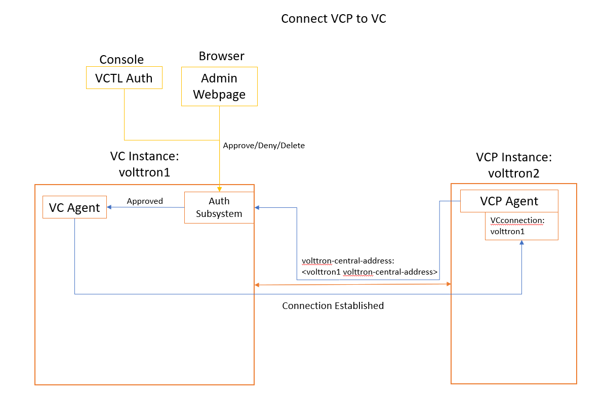

.. _VOLTTRON-Central-Platform-Agent:

===============================
Volttron Central Platform (VCP)
===============================

The VCP agent exposes a VOLTTRON instance to a Volttron Central (VC) agent. The VC
agent can either be on the same or a remote VOLTTRON instance. The VCP agent will,
once authenticated with the VC agent's instance, auto connect to the VC
agent's instance and register itself on startup. The VCP instance will attempt
to reconnect to the VC agent's instance if connection is disrupted.VCP has
many configuration options available that can be set via the configuration store.
An example config is provided below with information on these options.

Publish Specifications
----------------------

During connection to the VC agent's instance the instance-name from the VCP
will be used to connect to the VC agent's instance.  It will have the form
vcp-instance name with all invalid characters replaced with an underscore. See
:py:meth:`volttron.platform.agent.util.normalize_identity` for how the instance
name is normalized into a identity.

.. _VCP-Grant-Agent-Control:

Granting agent control to the VCP agent
---------------------------------------

The VCP agent is not granted the capabilities to install, remove, start or stop agents when it is installed. Until an
operator grants them, VOLTTRON Central cannot install or remove agents on the platform (``install_remove_agents``) or
start, stop or restart them (``start_stop_agents``). Grant both on each managed platform, with the platform running
and the VCP agent installed:

1. Find the index of the VCP agent's entry. It is the entry whose ``identity`` is ``platform.agent``:

   .. code-block:: bash

       vctl auth list

2. Update that entry, replacing ``<INDEX>`` with the index you found:

   .. code-block:: bash

       vctl auth update <INDEX>

   The command asks for each field in turn. Press Enter to keep a value. At the ``capabilities`` prompt, enter the
   entry's current capabilities plus the two new ones. A newly installed VCP agent has only ``edit_config_store``, so
   enter:

   .. code-block:: json

       {"edit_config_store": {"identity": "/.*/"}, "install_remove_agents": null, "start_stop_agents": null}

3. Run ``vctl auth list`` again and check that the entry now lists ``install_remove_agents`` and ``start_stop_agents``
   under ``capabilities``.

The ``capabilities`` answer replaces the old value, so include every capability the entry already has. The update
command also resets the entry's ``rpc_method_authorizations`` to empty, so check that field in the listing afterwards.

FAQ / Notes
-----------

* VCP agent has an identity of 'platform.agent'. This cannot be changed.
* There may only be a single agent connected to a VOLTTRON instance with the identity of 'platform.agent'
* From VC's perspective, the VCP agent's identity is <VCP Instance Name>.platform.agent
* VCP will publish to the remote platform under the topic platforms/vcp-(normalized instance name)/
* VC subscribes to platforms/* and gets status of the remote instance.
* VCP connects to the remote instance using the auth subsystem.  Once is connected to the remote instance, VCP's rpc
  functions are available for the remote VC to call.
* VC looks at the peers connected to the instance in order to determine what remote instances are connected to the
  platform (*.platform.agent are assumed to be VCP instances*).

|VCP-VC Connection|

Configuration Options
---------------------

The following JSON configuration file shows all the options currently supported
by the VCP agent.  By default an empty config file is used.

.. code-block:: python

    {
        # The volttron-central-address, volttron-central-serverkey and
        # instance-name may be set in the VCP instance configuration file or
        # or as command line parameters to the VOLTTRON instance.
        #
        # The volttron-central-address is either an http address or a tcp
        # address.  If it is an http address vc must be running at the resolution
        # of http://ip:port/discovery/.  VCP will use the tcp address and
        # serverkey in the response payload to connect to the VC agent instance.
        #
        # If the specified address is a tcp address then the configuration
        # must also contain a volttron-central-serverkey.
        "volttron-central-address": "http://ip<host>:port" or "tcp://ip:port",

        # The serverkey of the VC agent's instance.
        "volttron-central-serverkey" "VC agent's instance serverkey",

        # interval at which VCP will attempt to connect to the VC agent's
        # instance when a disconnection occurs.
        "volttron-central-reconnect-interval": 5,

        # The name of instance to be sent to volttron central for displaying
        # on the interface.
        "instance-name": "name of instances (VC agent's instance ip address as default)",

        # VCP will publish health statistics of the instance at a specified
        # interval.
        "stats-publish-interval": 30,

        # The VCP provides a topic/replace mapping for the platform.  It is
        # available via rpc function so that sensitive information won't be
        # published through forwarding.
        #
        # The topic-replace-map is used to search/replace all of the topics
        # published from ForwardHistorians and other agents that connect with
        # external instances.
        "topic-replace-map": {
            "from": "to",
            "from1": "to1"
        }
    }

